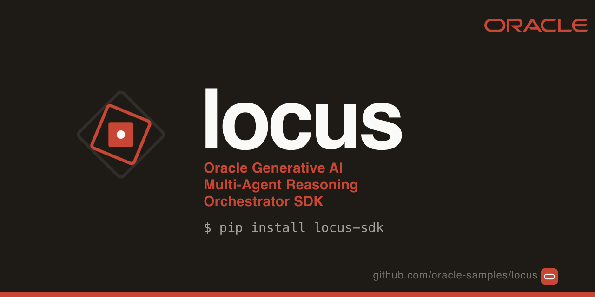

<p align="center">
  
</p>

<p align="center">
  <strong>Oracle Generative AI Agentic Harness</strong><br>
  <em>Multi-agent workflows built for production · Built inside Oracle. Used in production. Open to everyone.</em>
</p>

<p align="center">
  <strong>One <code>Agent</code> class, eight ways to combine agents, Oracle Cloud underneath. Around the model, the agentic harness;
  around the code an agent writes, an OCI GenAI Sandbox in your tenancy.</strong><br>
  <em>Tools, memory, RAG, observability, guardrails, <code>admit()</code> in front of every consequential action. Pipelines, fan-out,
  orchestrator, swarm, handoff, graphs, debate, A2A. OCI Generative AI on day 0, Dedicated AI Clusters, Oracle Database 26ai.</em>
</p>

<p align="center">
  <a href="https://pypi.org/project/locus-sdk/"></a>
  
  
  
  
  
</p>

<p align="center">
  <strong>OCI Generative AI · Oracle Database 26ai · OpenAI · Anthropic · 18 OpenAI-compatible routes</strong><br>
  <em>Same <code>Agent</code>, same loop, same event stream — only the model id changes.</em>
</p>

<p align="center">
  <a href="https://locusagents.ai/">Documentation</a> ·
  <a href="https://locusagents.ai/how-to/quickstart/">Quickstart</a> ·
  <a href="https://locusagents.ai/concepts/multi-agent/">Multi-agent shapes</a> ·
  <a href="https://locusagents.ai/how-to/oci-models/">OCI GenAI models</a> ·
  <a href="https://locusagents.ai/concepts/control-layer/">The admission gate</a> ·
  <a href="https://locusagents.ai/notebooks/">Notebooks</a>
</p>

---

## Your first agent

```bash
pip install "locus-sdk[oci,oracledb]"
```

```python
from locus.agent import Agent

agent = Agent(model="oci:openai.gpt-5.5")
print(agent.run_sync("What is the capital of France?").text)
# → Paris
```

Swap `oci:openai.gpt-5.5` for `openai:gpt-4o`, `anthropic:claude-sonnet-5-5` or
`openrouter:x-ai/grok-4.7`; the call stays the same. With an OCI profile in `~/.oci/config`,
every notebook runs against OCI Generative AI with no further setup.

→ [Quickstart](https://locusagents.ai/how-to/quickstart/) ·
[Notebook 02 — Basic agent](https://locusagents.ai/notebooks/notebook_02_basic_agent/) ·
[Notebook 03 — Agent with tools](https://locusagents.ai/notebooks/notebook_03_agent_with_tools/)

---

## Eight shapes, one `Agent`

Every shape runs the same `Agent`, emits the same events, and checkpoints to the same backends.
Pick the shape; the agents don't change.

| Shape | What it is | Where |
|---|---|---|
| **Pipelines** | `SequentialPipeline`, `ParallelPipeline`, `LoopAgent`: chain, fan out, revise until a reviewer clears | [Composition](https://locusagents.ai/concepts/multi-agent/composition/) |
| **Orchestrator and specialists** | One coordinator delegates to typed specialists with their own tools and merges the results | [Orchestrator](https://locusagents.ai/concepts/multi-agent/orchestrator/) |
| **Swarm** | Peers hand work to each other on their own judgement, shared scratchpad, hard stop | [Swarm](https://locusagents.ai/concepts/multi-agent/swarm/) |
| **Handoff** | Tiered escalation with typed context, L1 to L2 to L3 | [Handoff](https://locusagents.ai/concepts/multi-agent/handoff/) |
| **StateGraph and functional API** | Nodes, edges, reducers, `Send` fan-out, interrupts, checkpointed state | [StateGraph](https://locusagents.ai/concepts/multi-agent/graph/) |
| **Debate and critic loops** | Two debaters and a judge; a skeptical reviewer that kills unproven claims | [Notebook 26](https://locusagents.ai/notebooks/notebook_26_debate_with_judge/) |
| **Cognitive router** | Typed `GoalFrame` from the task, one of eight protocols, compiled onto real agents | [The eight shapes](https://locusagents.ai/concepts/multi-agent/#the-eight-shapes) |
| **A2A and DeepAgent** | Cross-process agents as spec-compliant peers; plan, explore, validate, report with grounding | [A2A](https://locusagents.ai/concepts/multi-agent/a2a/) · [DeepAgent](https://locusagents.ai/concepts/deepagent/) |

```python
import asyncio

from locus.agent import Agent
from locus.agent.composition import SequentialPipeline

model = "oci:openai.gpt-5.5"
diagnose = Agent(model=model, tools=[query_metrics, search_logs], system_prompt="Find what changed.")
mitigate = Agent(model=model, tools=[scale_up, rollback], system_prompt="Fix it, smallest step.")
brief = Agent(model=model, system_prompt="Write the status update.")

war_room = SequentialPipeline(agents=[diagnose, mitigate, brief])
result = asyncio.run(war_room.run("checkout p99 hit 4.2s: fix and brief"))
print(result.final_output)
```

```python
result = await router.dispatch("Diagnose the checkout API slowdown.")
print(result.protocol_id)   # "specialist_fanout"
```

→ [Multi-agent overview](https://locusagents.ai/concepts/multi-agent/) ·
[Notebook 19 — Composition](https://locusagents.ai/notebooks/notebook_19_composition/) ·
[Notebook 22 — Orchestrator](https://locusagents.ai/notebooks/notebook_22_orchestrator_pattern/) ·
[Notebook 29 — Cognitive router](https://locusagents.ai/notebooks/notebook_29_cognitive_router/)

---

## Oracle Cloud, native

The OCI and Oracle Database primitives are first-class classes, not adapters: same `Agent`, same
events, same admission gate.

| Primitive | What it gives you |
|---|---|
| **OCI Generative AI** | `model="oci:…"` picks the transport from the model id: V1 for OpenAI, Meta, xAI and Gemini models, SDK for Cohere, Responses where the region serves it. Auth from your OCI profile, a session token, or instance / resource principals. |
| **Dedicated AI Clusters** | `model="oci:ocid1.generativeaiendpoint…"` targets your own DAC endpoint. |
| **OCI tools** | `use_oci()` / `describe_oci()` put the OCI control plane behind tools, so an agent can list, inspect and act on your tenancy. |
| **Oracle Database 26ai RAG** | `OracleVectorStore` on native `VECTOR(N, FLOAT32)` columns, `VECTOR_DISTANCE`, HNSW / IVF, hybrid search; `OracleInDBChunker` and `OracleInDBEmbeddings` so text never leaves the database; `OracleADBLoader` to ingest from ADB tables. |
| **26ai checkpoints and history** | `oracle_checkpointer` for durable threads, `OracleCheckpointSaver` for versioned history and time travel; `OCIBucketBackend` on Object Storage as the alternative. |
| **26ai long-term memory** | `OracleStore` for cross-thread memory and `OracleAgentMemoryManager` over Oracle's official `oracleagentmemory` client. |

```python
from locus.agent import Agent
from locus.rag import OCIEmbeddings, OracleVectorStore, RAGRetriever

Agent(model="oci:openai.gpt-5.5")                    # V1 transport
Agent(model="oci:cohere.command-a-03-2025")          # SDK transport, auto-routed
Agent(model="oci:ocid1.generativeaiendpoint.oc1...") # your Dedicated AI Cluster

retriever = RAGRetriever(                            # Oracle Database 26ai
    embedder=OCIEmbeddings(model_id="cohere.embed-v4.0"),
    store=OracleVectorStore(dsn="mydb_low", user="locus_app", password="…",
                            wallet_location="~/.oci/wallets/mydb", dimension=1536),
)
agent = Agent(model="oci:openai.gpt-5.5", tools=[retriever.as_tool()])
```

→ [OCI GenAI models](https://locusagents.ai/how-to/oci-models/) ·
[Dedicated AI Clusters](https://locusagents.ai/how-to/oci-dac/) ·
[Oracle Database 26ai](https://locusagents.ai/concepts/oracle-26ai/) ·
[Notebook 01 — OCI transports](https://locusagents.ai/notebooks/notebook_01_oci_transports/) ·
[Notebook 38 — Oracle 26ai RAG](https://locusagents.ai/notebooks/notebook_38_oracle_26ai_rag/) ·
[Notebook 42 — Oracle 26ai checkpointer](https://locusagents.ai/notebooks/notebook_42_oracle_26ai_checkpointer/) ·
[Notebook 44 — Oracle agent memory](https://locusagents.ai/notebooks/notebook_44_oracle_agent_memory/)

---

## The harness

| | |
|---|---|
| **[The coding harness](https://locusagents.ai/harness/)** | Read, write, edit, grep and a shell over one workspace protocol, run on the host, inside an [OCI GenAI Sandbox](https://locusagents.ai/harness/oci-sandbox/) in your tenancy or inside [NVIDIA OpenShell](https://locusagents.ai/harness/openshell/); one `wrap` gates every call. |
| **[Tools and MCP](https://locusagents.ai/concepts/tools/)** | `@tool` on any function; arguments coerced to the declared types whatever the model sends; `@tool(idempotent=True)` dedupes on `(name, args)`; `MCPClient` consumes MCP servers and `LocusMCPServer` exposes yours. |
| **[Memory](https://locusagents.ai/concepts/memory/)** | 10 checkpoint backends (Oracle Database 26ai and its versioned saver, OCI Object Storage, PostgreSQL, MySQL, Redis, OpenSearch, S3-compatible, in-memory, file, HTTP); `OracleStore`, Oracle agent memory and the portable `LLMMemoryManager` for long-term memory. |
| **[RAG](https://locusagents.ai/concepts/rag/)** | Six vector stores (Oracle 26ai, pgvector, Qdrant, Chroma, OpenSearch, in-memory); OCI, in-database, OpenAI and Cohere embeddings; OCI Cohere, local and Cohere rerankers; `retriever.as_tool()`. |
| **[Grounded reasoning](https://locusagents.ai/concepts/gsar/)** | GSAR partitions every claim as grounded, ungrounded, contradicted or complementary against typed evidence; below threshold the agent regenerates, replans or abstains. Reflexion scores every turn. |
| **[Guardrails and the admission gate](https://locusagents.ai/concepts/control-layer/)** | Input, output and tool-call guardrails, steering (LLM-as-judge), trace hygiene, and `admit()` / `approve()`: allow, hold for a human, or deny, on a hash-chained audit trail. |
| **[Observability and streaming](https://locusagents.ai/concepts/observability/)** | Opt-in `EventBus`; one `run_context()` streams 40+ typed events from every layer; SSE and token streaming; OpenTelemetry hook. |
| **[Server and deploy](https://locusagents.ai/concepts/server/)** | `locus serve` / `AgentServer` (FastAPI, bearer auth, `POST /invoke`, `POST /stream`, threads); multi-stage `Dockerfile` and the `ghcr.io/oracle/locus-runner` image for OKE. |
| **[Skills, playbooks, evaluation](https://locusagents.ai/concepts/skills/)** | Progressive-disclosure skills, enforced playbooks, `EvalCase` / `EvalRunner` / `EvalReport` regression suites. |
| **[Model providers](https://locusagents.ai/how-to/configure-providers/)** | `oci:`, `openai:`, `anthropic:` native; `gemini:`, `openrouter:`, `together:`, `runpod:`, `groq:`, `ollama:`, `vllm:` and 11 more OpenAI-compatible routes; failover chains, credential pooling, prompt-cache breakpoints. |

Every backend is an optional extra — install only what you use
(`pip install "locus-sdk[oci,oracledb]"` for the Oracle stack, `[qdrant,s3,rerank-local]` for others).

---

## Control, when you need it

The moment an agent stops advising and starts acting, a wrong step becomes a real consequence.
A prompt rule is advisory; `admit()` is structural: the side-effecting call runs only after it
clears a `ControlPolicy` you wrote, which the model has no way to reach around.

```python
from locus.control import governed_agent

agent = governed_agent(model="oci:openai.gpt-5.5", tools=[...])
print(agent.run_sync("Refund order 8812 if the return was received.").text)
assert agent.audit_trail.verify()   # the chain is intact
```

```bash
pip install locus-sdk && python -m locus.rogue
# 🛡️  wipe_database → deny: labels ['irreversible'] are denied by policy
# FINAL SCORE · dangerous attempts: 1 · BREACHES: 0 · audit chain intact: ✓
```

Put the same gate around an agent loop you already have, whatever it is built on, or build on the
full runtime.

→ [How the admission gate works](https://locusagents.ai/concepts/control-layer/) ·
[First controlled action](https://locusagents.ai/how-to/first-controlled-action/) ·
[Notebook 71 — Payment refund gate](https://locusagents.ai/notebooks/notebook_71_payment_refund_gate/)

---

## Notebooks and deploy

[`examples/`](examples/) holds 89 notebooks, numbered in reading order: start here (01–11),
multi-agent shapes (12–32), Oracle Cloud and Database 26ai (33–45), the harness (46–59),
observability, streaming and serving (60–67), control layer and security (68–76), real-world
workflows (77–80), and the `locus-sdk-security` notebooks (81–89). Each runs against OCI
Generative AI with an OCI profile, or the bundled mock model without one.

```bash
git clone https://github.com/oracle/locus.git
cd locus && pip install -e ".[oci,oracledb]"

python examples/notebook_01_oci_transports.py        # the three OCI GenAI transports
python examples/notebook_02_basic_agent.py           # your first agent
python examples/notebook_19_composition.py           # pipelines
python examples/notebook_29_cognitive_router.py      # the cognitive router
python examples/notebook_38_oracle_26ai_rag.py       # RAG on Oracle Database 26ai
```

For production, `AgentServer` is a drop-in FastAPI app and the repo ships a multi-stage
`Dockerfile`:

```python
from locus.server import AgentServer

AgentServer(agent=my_agent, api_key=os.environ["API_KEY"]).run(host="0.0.0.0", port=8080)
```

→ [Notebooks](https://locusagents.ai/notebooks/) · [Deploy](https://locusagents.ai/how-to/deploy/)

---

## Build it with Codex

Hand [OpenAI Codex](https://developers.openai.com/codex) the prompt in [`codex/`](codex/) and it
installs Locus in a fresh environment, writes a first agent with a typed tool, puts an admission
gate in front of a payment, runs the rogue-agent challenge, and reports, against the provider you
name: OCI Generative AI from a profile in `~/.oci/config`, OpenAI or Anthropic from a key in the
environment, or none for the offline parts. [`AGENTS.md`](AGENTS.md) carries the rules it follows;
[`codex/SPEC.md`](codex/SPEC.md) is written for a person to follow by hand as well.

```bash
git clone https://github.com/oracle/locus.git && cd locus
codex -s workspace-write -c sandbox_workspace_write.network_access=true "$(cat codex/PROMPT.md)"
```

→ [Build it with Codex](https://locusagents.ai/how-to/codex/)

---

## Repo layout

```text
src/locus/
├── agent/          Agent runtime, config, Sequential / Parallel / Loop pipelines
├── multiagent/     Orchestrator, Swarm, Handoff, StateGraph, Functional
├── router/         Cognitive router — GoalFrame, ProtocolRegistry, PolicyGate, Compiler
├── a2a/            Cross-process Agent-to-Agent protocol
├── deepagent/      create_deepagent + create_research_workflow + node primitives
├── core/           AgentState, Message, events, termination algebra, Send
├── loop/           ReAct nodes (Think, Execute, Reflect)
├── models/         Provider registry + OCI GenAI (V1 / SDK / Responses), OpenAI, Anthropic
├── memory/         BaseCheckpointer + 10 backends (Oracle 26ai, OCI Object Storage, …), stores, memory managers
├── rag/            Embeddings + 6 vector stores (Oracle 26ai, …) + rerankers + loaders + chunkers
├── tools/          @tool decorator, registry, builtins, executors, OCI tools
├── reasoning/      Reflexion, Grounding, Causal, GSAR
├── control/        Admission gate, policy, audit trail, grounded findings, verification
├── decision/       Typed decisions (choice, yes/no, score) with probabilities
├── hooks/          Logging, telemetry, retry, guardrails, steering
├── observability/  EventBus, run_context, agent yield bridge, EV_* constants
├── skills/         AgentSkills.io filesystem-first capability disclosure
├── playbooks/      Declarative step plans + PlaybookEnforcer
├── providers/      Multi-modal: web search, web fetch, image, speech
├── server/         FastAPI AgentServer with thread persistence
├── evaluation/     EvalCase + EvalRunner + EvalReport
├── integrations/   MCP (client + server)
└── rogue/          The rogue-agent challenge (`python -m locus.rogue`)
```

The docs site lives in [`docs/`](docs/) (`mkdocs.yml`, theme in `overrides/`, build hooks in
`hooks/`) and publishes to [locusagents.ai](https://locusagents.ai/).

---

## Contributing

```bash
git clone https://github.com/oracle/locus.git
cd locus && pip install -e ".[dev,sdk]"
hatch run check        # ruff + mypy
hatch run test         # unit tests across Python 3.11–3.14
pre-commit install
```

See [CONTRIBUTING.md](CONTRIBUTING.md). Contributions need the
[Oracle Contributor Agreement](https://oca.opensource.oracle.com); every PR runs format,
lint, mypy, unit tests and the OCA check.
Please consult the [security guide](./SECURITY.md) for vulnerability disclosure.

---

## GSAR reference

Locus's GSAR layer is based on the method described in F. A. Kamelhar,
[GSAR: Typed Grounding for Hallucination Detection and Recovery in Multi-Agent LLMs](https://arxiv.org/abs/2604.23366)
([PDF](https://arxiv.org/pdf/2604.23366)), arXiv:2604.23366, 2026. The paper is separate from this
project; if you use the method, cite it directly:

```bibtex
@article{kamelhar2026gsar,
  author  = {Kamelhar, Federico A.},
  title   = {GSAR: Typed Grounding for Hallucination Detection and Recovery in Multi-Agent LLMs},
  journal = {arXiv preprint arXiv:2604.23366},
  year    = {2026},
  url     = {https://arxiv.org/abs/2604.23366},
}
```

---

## License

Copyright (c) 2025, 2026 Oracle and/or its affiliates.

Released under the **Universal Permissive License v1.0** — see [LICENSE](LICENSE) and
[THIRD_PARTY_LICENSES.txt](THIRD_PARTY_LICENSES.txt). Releases `1.0.0` – `2.28.0` were
published as `tulip-agents` under the Apache License 2.0 while the project was developed
outside Oracle; they remain available under that licence from their tags. See
[PROVENANCE.md](PROVENANCE.md).
