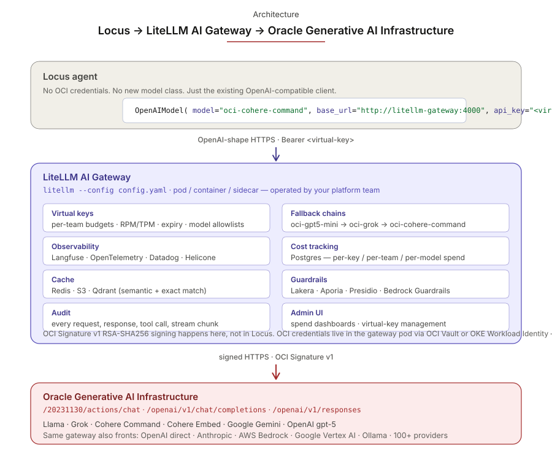

# Running Locus behind the LiteLLM AI Gateway

[LiteLLM](https://litellm.ai) ships an open-source proxy — variously
branded the **LiteLLM Proxy Server** and the **LiteLLM AI Gateway** —
that fronts 100+ model providers behind one OpenAI-shaped HTTP API.



When you put it in front of Oracle Generative AI Infrastructure (and
optionally other providers), Locus consumes it through its existing
[`OpenAIModel`](../concepts/providers/openai.md) with no Locus-side code
change. The gateway carries the parts of the integration that genuinely
belong in a gateway: virtual keys, per-team budgets, fallback chains,
centralised observability, cost reporting, caching, and guardrails.

```text
Locus agent
   │  OpenAIModel(base_url="http://litellm-gateway:4000", api_key="<virtual-key>")
   ▼
LiteLLM Proxy Server  (config.yaml carries every provider + key)
   │
   ├──► OCI Generative AI  (/20231130/actions/chat — vendor adapters)
   ├──► OpenAI direct
   ├──► Anthropic
   ├──► AWS Bedrock
   └──► … 100+ providers
```

!!! warning "Scope: the gateway covers OCI's native API path only"
    LiteLLM's OCI provider targets OCI's **native** chat endpoint at
    ``/20231130/actions/chat`` with vendor adapters (Cohere v1 transport
    for `cohere.*`, GENERIC apiFormat for Grok / Llama / Gemini / gpt-5).
    It does **not** wrap OCI's ``/openai/v1/chat/completions`` shim or
    its ``/openai/v1/responses`` endpoint.

    If you specifically need:

    - the OCI OpenAI Chat-Completions V1 shim → use
      [`OCIChatCompletionsModel`](oci-models.md#v1-transport-ocichatcompletionsmodel)
      directly.
    - server-stateful OCI Responses API (``previous_response_id``,
      Responses-only models like `openai.gpt-5.5-pro`) → use
      [`OCIResponsesModel`](oci-models.md#responses-transport-ociresponsesmodel-opt-in)
      directly.

    The gateway is the right answer for the OCI native path plus
    cross-provider routing; the direct providers are the right answer
    for OCI's other two surfaces.

    Locus has **zero `litellm` Python dependency** — the package only
    lives inside the gateway's Docker container. Your Locus services
    only need `openai` (already pulled by `OpenAIModel`).

## When to choose this over the direct OCI providers

Locus's [direct OCI model providers](oci-models.md) remain the right
default for **single-tenant production, dev / CI, and on-OKE workload
identity** — they're simpler, in-process, lower-latency, and have no
extra service to operate.

**Reach for the gateway when** you need:

- **Multi-tenant key management** — issue virtual keys per team / agent
  / customer with per-key budgets, RPM/TPM limits, expiry, and model
  allowlists.
- **Fallback chains across regions or providers** — "OCI us-chicago-1
  → OCI us-ashburn-1 → external Anthropic" defined in `config.yaml`,
  no Locus restart.
- **Centralised observability** — one Langfuse / OpenTelemetry /
  Datadog / Helicone hook configured in the gateway, every Locus
  service feeds it.
- **Centralised cost tracking** — Postgres-backed per-key / per-team /
  per-model spend reporting across every consumer.
- **Polyglot consumers** — Python Locus, JS workbench, Ruby / Go
  services all talk OpenAI to the same gateway.
- **Caching across services** — Redis / S3 / Qdrant in-flight, shared
  across every consumer.

If none of those apply, **prefer the direct OCI providers**. The
gateway is an extra deployment, not a shortcut.

## Quickstart — local Docker

The `examples/litellm-gateway/` directory ships a working sample:

```bash
cd examples/litellm-gateway/

# Populate the OCI credentials the gateway will use to sign upstream calls.
# These live in the *gateway's* environment, not in your Locus app.
export OCI_REGION="us-chicago-1"
export OCI_USER="ocid1.user.oc1..xxx"
export OCI_FINGERPRINT="aa:bb:cc:..."
export OCI_TENANCY="ocid1.tenancy.oc1..xxx"
export OCI_KEY_FILE="$HOME/.oci/keys/your_api_key.pem"
export OCI_COMPARTMENT_ID="ocid1.compartment.oc1..xxx"

docker compose up
```

The gateway listens on `http://localhost:4000` and exposes the model
aliases declared in `config.yaml`. The sample ships six:
`oci-cohere-command`, `oci-cohere-embed`, `oci-grok`, `oci-gpt5-mini`,
`oci-llama-4-maverick`, and `oci-gemini-2.5-flash`. Add more by
extending `model_list`.

Verify with a `curl`:

```bash
curl -s http://localhost:4000/v1/models \
  -H "Authorization: Bearer $LITELLM_VIRTUAL_KEY" | jq '.data[].id'
```

## Issuing per-team virtual keys

The gateway's master key (`LITELLM_MASTER_KEY`) is the admin token —
treat it as a high-value secret and **never hand it to a Locus
agent**. Locus services should each carry a scoped **virtual key**
issued via the gateway's `/key/generate` endpoint:

```bash
curl http://localhost:4000/key/generate \
  -H "Authorization: Bearer $LITELLM_MASTER_KEY" \
  -H "Content-Type: application/json" \
  -d '{
    "models":   ["oci-cohere-command"],
    "max_budget": 5.00,
    "duration": "24h",
    "metadata": {"team": "platform-demo", "owner": "fede"}
  }'
```

Response (truncated):

```json
{
  "key": "sk-<example-virtual-key-here>",
  "models": ["oci-cohere-command"],
  "max_budget": 5.0,
  "spend": 0.0,
  "metadata": {"team": "platform-demo", "owner": "fede"}
}
```

The gateway enforces every field at request time:

- **Model allowlist** — a key with `models: ["oci-cohere-command"]`
  trying to call `oci-gpt5-mini` gets rejected:
  `key not allowed to access model. This key can only access
  models=['oci-cohere-command']. Tried to access oci-gpt5-mini`.
- **Budget** — when cumulative spend exceeds `max_budget`, subsequent
  calls 429.
- **Expiry** — `duration: "24h"` automatically deactivates the key
  after 24 hours.
- **Metadata** is attached to every request the key makes, so spend
  reporting and audit logs can group by `team` / `owner` / whatever
  fields you put there.

!!! note "`/key/generate` requires Postgres"
    The `docker-compose.yml` in this sample includes a Postgres sidecar
    for virtual-key storage. Without it the gateway returns
    `{"error": "DB not connected"}` for `/key/generate`. In production
    point `DATABASE_URL` at an external Postgres (e.g. an OCI ADB
    instance) so the gateway pod itself stays stateless.

## Cost tracking

The same Postgres backend logs every request automatically with token
counts and computed cost. No extra config beyond connecting the DB.
The full admin / analytics API is documented at
[docs.litellm.ai/docs/proxy/cost_tracking](https://docs.litellm.ai/docs/proxy/cost_tracking);
the snippets below cover the three endpoints the sample deployment
relies on, with sample output captured live from this PR's
validation run.

```bash
# Per-request spend log (flushed asynchronously every ~10s by default).
curl http://localhost:4000/spend/logs \
  -H "Authorization: Bearer $LITELLM_MASTER_KEY"

# Aggregate spend grouped by virtual key.
curl http://localhost:4000/global/spend/keys \
  -H "Authorization: Bearer $LITELLM_MASTER_KEY"
```

Sample output:

```text
/spend/logs
  · model=oci/cohere.command-latest  tokens=11  cost=$0.000017
  · model=oci/cohere.command-latest  tokens=10  cost=$0.000016
  · model=oci/cohere.command-latest  tokens=9   cost=$0.000014

/global/spend/keys
  · key=sk-<example-vkey-1>...  total_spend=$0.000034
  · key=sk-<example-vkey-2>...  total_spend=$0.000014
```

LiteLLM ships an internal pricing table covering every model it
routes (so OCI's per-token pricing is applied automatically). Spend
is keyed by `api_key`, `user`, `team_id`, and any custom field in
`metadata`, so the same SQL surface answers "what did team X spend
this week?" and "what did model Y cost across all teams?".

The full admin / analytics API is documented at
[docs.litellm.ai/docs/proxy/cost_tracking](https://docs.litellm.ai/docs/proxy/cost_tracking).

## Pointing Locus at the gateway

Use the existing `OpenAIModel` — that's the LiteLLM-compatible client:

```python
from locus.agent import Agent
from locus.models.native.openai import OpenAIModel

model = OpenAIModel(
    model="oci-cohere-command",                  # alias from gateway config.yaml
    api_key="$LITELLM_VIRTUAL_KEY",                      # virtual key issued by the gateway
    base_url="http://localhost:4000",            # the LiteLLM AI Gateway
)

agent = Agent(model=model, system_prompt="You are concise.")
print(agent.run_sync("hi").message)
```

No new Locus class is needed. The gateway handles OCI RSA-SHA256
signing, vendor adapters (Cohere `preamble` / `chatHistory`, GENERIC
apiFormat for Grok / Llama / Gemini), fallback, budgets, and
observability internally. Locus only ever sees the OpenAI-shaped
HTTP contract.

## Running existing notebooks through the gateway

Every `examples/notebook_*.py` already routes model construction
through `examples/config.py:get_model()`, which honors
`LOCUS_MODEL_PROVIDER=openai` plus the standard `OPENAI_BASE_URL` /
`OPENAI_API_KEY` env vars. So pointing every notebook at the gateway
is a four-line shell change — no code edits:

```bash
docker compose -f examples/litellm-gateway/docker-compose.yml up -d

export LOCUS_MODEL_PROVIDER=openai
export LOCUS_MODEL_ID=oci-cohere-command          # alias from config.yaml
export OPENAI_BASE_URL=http://localhost:4000
export OPENAI_API_KEY=$LITELLM_VIRTUAL_KEY                # gateway virtual key

python examples/notebook_06_basic_agent.py
python examples/notebook_07_agent_with_tools.py
# …
```

## Deploying on OKE

The sample [`helm-values.yaml`](https://github.com/oracle-samples/locus/blob/main/examples/litellm-gateway/helm-values.yaml)
in `examples/litellm-gateway/` plugs into LiteLLM's official Helm chart
([`ghcr.io/berriai/litellm-helm`](https://github.com/BerriAI/litellm/tree/main/deploy/charts/litellm-helm)).
The recommended deployment shape is:

- One LiteLLM gateway Deployment per environment.
- OCI credentials wired in via Kubernetes secrets, sourced from OCI Vault
  (or via the gateway pod's OKE Workload Identity if you'd rather not
  mount a long-lived signing key at all — see "Authentication" below).
- Postgres for virtual-key state and spend logs.
- Service exposed cluster-internal only — Locus services hit it via
  the in-cluster DNS name (`litellm-gateway.litellm.svc.cluster.local:4000`).

Don't expose the gateway publicly — issuing virtual keys is your
auth boundary, but the OCI credentials inside the gateway are not.

## Authentication

The gateway changes the credential boundary:

| Without gateway | With gateway |
|---|---|
| Locus → OCI directly. Locus carries the OCI signing key (or uses OKE Workload Identity). | Locus → gateway with a **virtual key**. Gateway → OCI with the OCI signing key (or its own OKE Workload Identity). |

So **Locus no longer needs OCI credentials at all** — the gateway is
the only thing that does. Locus only needs the virtual API key the
gateway issued it. This is the central reason to deploy the gateway
on a multi-tenant platform: agents from different teams use different
virtual keys with different budgets, all hitting the same underlying
OCI tenancy.

On OKE, run the gateway pod with workload identity targeting the OCI
compartment, and OCI signing keys never have to land on disk anywhere.

## What lives in `config.yaml`

The sample `examples/litellm-gateway/config.yaml` declares the OCI
provider entries (one per model you want to expose), a virtual-key
section (mock or Postgres-backed), and the global gateway settings.
The full schema is documented at
[docs.litellm.ai/docs/proxy/configs](https://docs.litellm.ai/docs/proxy/configs).
Highlights:

- **`model_list`** — every model alias the gateway exposes. The same
  alias is what Locus passes as `model=` to `OpenAIModel`.
- **`general_settings.master_key`** — the admin key that creates
  per-team virtual keys via `/key/generate`.
- **`router_settings.fallbacks`** — fallback chains across model
  aliases (e.g. `[{"oci-gpt5-mini": ["oci-grok"]}]`).
- **`litellm_settings.callbacks`** — observability hooks (Langfuse,
  OTel, Datadog, …).
- **`litellm_settings.cache`** — Redis / S3 / Qdrant caching config.

## How enterprises use this pattern

The recurring deployment shape inside large organisations adopting
LLMs across many teams is *one gateway per environment, owned by a
platform team, fronting every provider, accessed by every service*.

The platform-grade pieces it earns them:

- **Charge-back / showback** — finance pulls a SQL report keyed on
  virtual key + `team` metadata; per-team costs roll up without
  manual reconciliation.
- **Compliance, audit, data residency** — append-only spend log
  (ISO-27001 / SOC-2 / PCI-friendly); PII redaction via guardrails
  *before* prompts leave the tenancy.
- **Centralised governance** — security/IT control which providers,
  models, and regions are approved; engineering can't bypass.
- **Vendor diversification** — declarative fallback chains across
  regions and providers; application code stays one `OpenAIModel` call.
- **Quota arbitration** — per-key `rpm_limit` / `tpm_limit` /
  `max_budget` lets the platform team fair-share shared vendor quotas.
- **Observability** — `success_callback` / `failure_callback` push
  LLM spans into the existing Datadog / OTel / Splunk pipeline.
- **Cost optimisation that compounds** — cache identical prompts,
  route cheap requests to cheap models, identify top-spend prompts
  and rewrite them. All require centralised visibility.
- **Polyglot consumers** — Python Locus, JS workbench, Go / Ruby /
  Java services all talk the same OpenAI-shaped HTTP.

### Deployment-shape table

| Layer | Owner | Lives in |
|---|---|---|
| OCI tenancy + IAM + signing keys | Cloud / security team | OCI Vault, OKE Workload Identity |
| Gateway pod + Postgres + Redis + obs backends | Platform / SRE team | Kubernetes (OKE), one deployment per env |
| Gateway `config.yaml` (model catalog, fallbacks, callbacks, guardrails) | Platform team | GitOps repo, change-controlled |
| Virtual keys + per-team budgets | Platform team issues; security reviews | Postgres; admin UI for issuance |
| Locus agents / workbench / other consumers | Application teams | Their own services, talking to `litellm-gateway.<env>.svc.cluster.local:4000` |
| Spend reports + audit + alerts | Finance + security | SQL on the gateway's Postgres; obs dashboards |

The pattern lets the platform team **set policy once** and application
teams **consume it through a single contract** — without anyone writing
provider-specific integration code or holding provider credentials.
LiteLLM's own [enterprise documentation](https://docs.litellm.ai/docs/proxy/enterprise)
covers each surface (callbacks, cache, guardrails, audit) in depth.

## See also

- [`docs/how-to/oci-models.md`](oci-models.md) — direct OCI providers
  (`OCIChatCompletionsModel`, `OCIResponsesModel`, `OCIModel`). The
  default for single-tenant deployments.
- [`examples/litellm-gateway/`](https://github.com/oracle-samples/locus/tree/main/examples/litellm-gateway)
  — working `config.yaml`, `docker-compose.yml`, and `helm-values.yaml`.
- [LiteLLM AI Gateway quickstart](https://docs.litellm.ai/docs/proxy/quick_start)
- [LiteLLM `config.yaml` reference](https://docs.litellm.ai/docs/proxy/configs)
- [LiteLLM Helm chart](https://github.com/BerriAI/litellm/tree/main/deploy/charts/litellm-helm)
